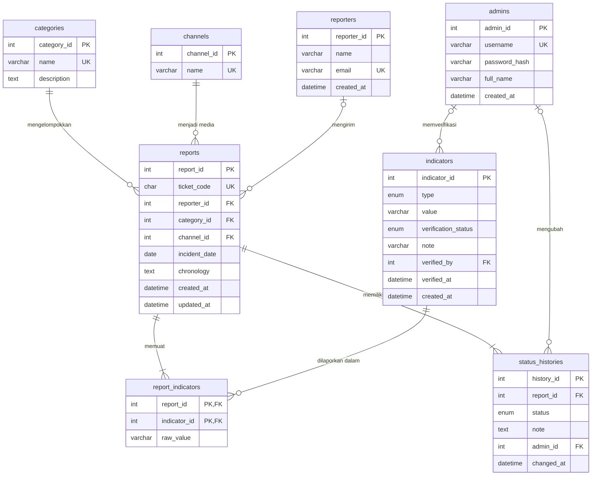

# Tahap 2a — Desain Database

Proyek: **LaPhish: Lapor dan Cek Phishing di Kampus**
Dasar: kebutuhan di `01_analisis_kebutuhan.md`.

Nama tabel dan kolom memakai bahasa Inggris (`snake_case`). Label di antarmuka tetap berbahasa Indonesia.
Semua contoh domain memakai akhiran `.example`, yang memang dicadangkan untuk contoh (RFC 2606), sehingga tidak mengarah ke situs sungguhan.

## 1. Daftar tabel

| No | Tabel | Isi | Dipakai oleh |
|---|---|---|---|
| 1 | `admins` | Akun petugas unit TI | FR-06 |
| 2 | `categories` | Jenis phishing | FR-11 |
| 3 | `channels` | Media datangnya phishing | FR-12 |
| 4 | `reporters` | Identitas pelapor (opsional) | FR-02 |
| 5 | `reports` | Laporan insiden | FR-02, FR-03, FR-08 |
| 6 | `indicators` | URL, email, atau nomor yang dilaporkan | FR-05, FR-10 |
| 7 | `report_indicators` | Penghubung laporan ↔ indikator (banyak-ke-banyak) | FR-02, FR-10 |
| 8 | `status_histories` | Riwayat perubahan status laporan (satu-satunya tempat status disimpan) | FR-04, FR-07, FR-09 |

Ditambah satu **VIEW** (tabel virtual yang tidak menyimpan data): `v_report_status`, untuk membaca status terakhir setiap laporan. Lihat bagian 6.

Semua tabel memakai `ENGINE=InnoDB` dan charset `utf8mb4`. InnoDB wajib dipakai karena engine lain (misalnya MyISAM) mengabaikan foreign key tanpa memunculkan pesan galat.

## 2. ERD



**Membaca kardinalitas:**
- Satu kategori atau kanal dipakai oleh nol sampai banyak laporan. Setiap laporan wajib punya tepat satu kategori dan satu kanal.
- Satu laporan boleh tanpa pelapor (anonim). Satu pelapor bisa mengirim banyak laporan.
- Laporan dan indikator berelasi **banyak-ke-banyak**: satu laporan bisa memuat beberapa indikator, dan satu tautan bisa dilaporkan oleh banyak orang. Relasi ini dipecah lewat `report_indicators`.
- Setiap laporan wajib punya minimal satu indikator. Sebaliknya, indikator boleh tidak terkait laporan mana pun (misalnya ditambahkan admin dari peringatan resmi).
- Setiap laporan punya minimal satu riwayat status, yaitu status "baru" saat laporan dibuat.

## 3. Kamus data

Keterangan: PK = primary key, FK = foreign key, UK = unique, AI = auto increment.

### `admins`
| Kolom | Tipe | Aturan | Keterangan |
|---|---|---|---|
| admin_id | INT | PK, AI | |
| username | VARCHAR(50) | UK, NOT NULL | |
| password_hash | VARCHAR(255) | NOT NULL | Hasil `password_hash()` |
| full_name | VARCHAR(100) | NOT NULL | |
| created_at | DATETIME | DEFAULT CURRENT_TIMESTAMP | |

### `categories`
| Kolom | Tipe | Aturan | Keterangan |
|---|---|---|---|
| category_id | INT | PK, AI | |
| name | VARCHAR(100) | UK, NOT NULL | Contoh: Pencurian akun |
| description | TEXT | NULL | |

### `channels`
| Kolom | Tipe | Aturan | Keterangan |
|---|---|---|---|
| channel_id | INT | PK, AI | |
| name | VARCHAR(50) | UK, NOT NULL | Contoh: WhatsApp |

### `reporters`
| Kolom | Tipe | Aturan | Keterangan |
|---|---|---|---|
| reporter_id | INT | PK, AI | |
| name | VARCHAR(100) | NULL | |
| email | VARCHAR(150) | UK, NULL | Hanya untuk dihubungi admin, tidak tampil di halaman publik |
| created_at | DATETIME | DEFAULT CURRENT_TIMESTAMP | |

Baris `reporters` hanya dibuat jika pelapor mengisi minimal satu kolom identitas. Email bersifat UNIQUE tetapi boleh NULL (MariaDB mengizinkan banyak NULL pada kolom UNIQUE), sehingga satu email hanya tercatat sekali. Aturan pemakaiannya ada di bagian 7.

### `reports`
| Kolom | Tipe | Aturan | Keterangan |
|---|---|---|---|
| report_id | INT | PK, AI | |
| ticket_code | CHAR(11) | UK, NOT NULL | Kode acak berformat `LP-XXXXXXXX` (8 karakter huruf besar/angka), dibuat dengan `random_bytes()`. Sengaja tidak berurutan agar tidak bisa ditebak, dan tidak memuat tanggal karena tanggal sudah ada di `created_at` |
| reporter_id | INT | FK → reporters, NULL, ON DELETE SET NULL | NULL berarti anonim |
| category_id | INT | FK → categories, NOT NULL, ON DELETE RESTRICT | |
| channel_id | INT | FK → channels, NOT NULL, ON DELETE RESTRICT | |
| incident_date | DATE | NOT NULL | Tidak boleh tanggal di masa depan |
| chronology | TEXT | NOT NULL | |
| created_at | DATETIME | DEFAULT CURRENT_TIMESTAMP | |
| updated_at | DATETIME | NULL, ON UPDATE CURRENT_TIMESTAMP | Kosong sampai laporan pertama kali diedit admin |

Tabel ini tidak menyimpan status. Status terakhir dibaca dari `v_report_status`.

### `indicators`
| Kolom | Tipe | Aturan | Keterangan |
|---|---|---|---|
| indicator_id | INT | PK, AI | |
| type | ENUM('url','email','phone') | NOT NULL | |
| value | VARCHAR(500) | NOT NULL | Nilai yang sudah dinormalisasi |
| verification_status | ENUM('belum','phishing','bukan_phishing') | NOT NULL, DEFAULT 'belum' | Menentukan hasil fitur Cek. Juga menjadi label untuk fase DS nanti |
| note | VARCHAR(255) | NULL | Catatan admin, misalnya alasan verifikasi atau sumber indikator yang ditambahkan admin ("peringatan resmi BSSN") |
| verified_by | INT | FK → admins, NULL, ON DELETE SET NULL | |
| verified_at | DATETIME | NULL | |
| created_at | DATETIME | DEFAULT CURRENT_TIMESTAMP | |

Kombinasi `(type, value)` bersifat UNIQUE, sehingga tautan yang sama tidak tersimpan dua kali.

Indikator boleh tidak terkait laporan mana pun, yaitu jika ditambahkan langsung oleh admin atau jika laporannya sudah dihapus. Karena itu hasil fitur Cek ditentukan oleh `verification_status`, bukan oleh jumlah laporan (lihat bagian 7).

**Bedanya dengan status laporan:** status di `status_histories` menggambarkan penanganan **kasus** (laporan ini sudah ditinjau atau belum). `verification_status` menggambarkan **fakta tentang tautan/nomor/email itu** (berbahaya atau tidak), yang dipakai oleh fitur Cek untuk semua orang.

### `report_indicators`
| Kolom | Tipe | Aturan | Keterangan |
|---|---|---|---|
| report_id | INT | PK, FK → reports, ON DELETE CASCADE | |
| indicator_id | INT | PK, FK → indicators, ON DELETE RESTRICT | |
| raw_value | VARCHAR(500) | NOT NULL | Teks asli yang diketik pelapor, sebelum dinormalisasi |

`raw_value` disimpan di sini, bukan di `indicators`, karena nilainya bergantung pada pasangan laporan dan indikator: dua orang bisa mengetik tautan yang sama dengan cara berbeda (`https://…` dan `www.…`). Teks asli ini juga berguna untuk fase DS nanti, karena fitur seperti pemakaian `https` hilang setelah normalisasi.

### `status_histories`
| Kolom | Tipe | Aturan | Keterangan |
|---|---|---|---|
| history_id | INT | PK, AI | |
| report_id | INT | FK → reports, NOT NULL, ON DELETE CASCADE | |
| status | ENUM('baru','ditinjau','valid','tidak_valid') | NOT NULL | |
| note | TEXT | NULL | Catatan admin, ikut tampil di halaman lacak |
| admin_id | INT | FK → admins, NULL, ON DELETE SET NULL | NULL untuk entri "baru" saat laporan dikirim |
| changed_at | DATETIME | DEFAULT CURRENT_TIMESTAMP | |

Mengubah status cukup dengan satu `INSERT` baris baru. Baris lama tidak pernah diubah, sehingga riwayatnya utuh.

## 4. Aturan ON DELETE dan alasannya

| Relasi | Aturan | Alasan |
|---|---|---|
| categories/channels → reports | RESTRICT | Data induk yang masih dipakai tidak boleh hilang (FR-13). |
| reporters → reports | SET NULL | Jika data pelapor dihapus (misalnya atas permintaan privasi), laporannya tetap ada sebagai laporan anonim. Di fase 1 tidak ada halaman untuk menghapus pelapor; penghapusan dilakukan lewat phpMyAdmin dan bisa dipakai untuk demo aturan ini. |
| reports → report_indicators, status_histories | CASCADE | Penghubung dan riwayat tidak bermakna tanpa laporannya. |
| indicators → report_indicators | RESTRICT | Indikator yang masih menjadi bukti laporan tidak boleh dihapus, agar setiap laporan tetap punya minimal satu indikator. Jika ternyata aman, cukup ditandai `bukan_phishing`. Indikator yang tidak terkait laporan boleh dihapus (FR-13). |
| admins → status_histories, indicators | SET NULL | Riwayat tetap tersimpan walaupun akun admin dihapus. |

## 5. Normalisasi

Contoh data mentah diambil dari formulir laporan seperti yang biasanya dicatat manual di spreadsheet.

### Bentuk tidak normal (UNF)
| Tiket | Pelapor | Email pelapor | Kategori | Ket. kategori | Kanal | Tanggal | Indikator | Status |
|---|---|---|---|---|---|---|---|---|
| LP-7F3K9QX2 | Rina | rina@kampus.example | Pencurian akun | Halaman login palsu untuk mencuri akun | WhatsApp | 2026-11-02 | `https://sso-kampus-verify.example/login`, `0812-0000-1111` | ditinjau |
| LP-M4T8B2PA | (anonim) | – | Pencurian akun | Halaman login palsu untuk mencuri akun | Email | 2026-11-03 | `www.sso-kampus-verify.example/login/` | baru |

Masalahnya: satu sel berisi lebih dari satu nilai, nama dan keterangan kategori diketik berulang, dan tautan yang sama ditulis dengan cara berbeda sehingga tidak bisa dicocokkan.

### 1NF: nilai atomik
Setiap indikator dipecah menjadi satu baris, dengan jenis dan nilainya dipisah.

| Tiket | Pelapor | Email pelapor | Kategori | Ket. kategori | Kanal | Tanggal | Jenis | Nilai indikator | Status |
|---|---|---|---|---|---|---|---|---|---|
| LP-7F3K9QX2 | Rina | rina@kampus.example | Pencurian akun | Halaman login palsu… | WhatsApp | 2026-11-02 | url | `https://sso-kampus-verify.example/login` | ditinjau |
| LP-7F3K9QX2 | Rina | rina@kampus.example | Pencurian akun | Halaman login palsu… | WhatsApp | 2026-11-02 | phone | `0812-0000-1111` | ditinjau |
| LP-M4T8B2PA | – | – | Pencurian akun | Halaman login palsu… | Email | 2026-11-03 | url | `www.sso-kampus-verify.example/login/` | baru |

Kunci gabungannya adalah (Tiket, Jenis, Nilai indikator). Data laporan masih terulang di setiap baris indikator.

### 2NF: hilangkan ketergantungan parsial
Kolom pelapor, email pelapor, kategori, keterangan kategori, kanal, tanggal, dan status hanya bergantung pada **Tiket**, bukan pada seluruh kunci. Karena itu tabel dipecah menjadi:
- `reports` (tiket, pelapor, email pelapor, kategori, keterangan kategori, kanal, tanggal, status)
- `indicators` (jenis, nilai yang sudah dinormalisasi). Kedua tautan di atas menjadi satu baris: `sso-kampus-verify.example/login`.
- `report_indicators` (tiket, indikator, teks asli)

### 3NF: hilangkan ketergantungan transitif
Di `reports` hasil 2NF, beberapa kolom tidak bergantung langsung pada Tiket, tetapi lewat kolom bukan kunci:
- `Tiket → Email pelapor → Nama pelapor`. Email menjadi penanda orangnya, dan nama ditentukan oleh email itu, bukan oleh laporannya. Nama dan email dipindah ke `reporters`, dan `reports` menyimpan `reporter_id`.
- `Tiket → Kategori → Keterangan kategori`. Keterangan ditentukan oleh kategorinya. Jika tetap di `reports`, mengubah keterangan satu kategori berarti mengubah banyak baris (anomali update). Kategori dan keterangannya dipindah ke `categories`, dan `reports` menyimpan `category_id`.
- Kanal dipisah ke `channels` dengan pola yang sama, agar penulisan nama kanal seragam dan perubahan nama cukup dilakukan di satu baris. `reports` menyimpan `channel_id`.

### Keputusan desain: pemisahan status
Pemisahan status bukan bagian dari langkah normalisasi di atas, melainkan keputusan desain untuk mencatat riwayat. Setiap perubahan status punya waktu, catatan, dan admin sendiri, dan perubahan baru tidak boleh menimpa yang lama. Karena itu status disimpan sebagai baris-baris di `status_histories` dan **tidak** disimpan di `reports`, sehingga tidak ada data yang tersimpan di dua tempat. Status terakhir dibaca lewat view (bagian 6).

Hasil akhirnya adalah 8 tabel seperti di ERD, semuanya dalam 3NF.

## 6. VIEW `v_report_status`

Karena status hanya disimpan di `status_histories`, status terakhir setiap laporan dibaca lewat VIEW berikut. VIEW tidak menyimpan data. Isinya hanya kueri yang tersimpan, jadi tidak menimbulkan redundansi.

```sql
CREATE VIEW v_report_status AS
SELECT h.report_id, h.status, h.changed_at
FROM status_histories h
WHERE h.history_id = (
    SELECT MAX(h2.history_id)
    FROM status_histories h2
    WHERE h2.report_id = h.report_id
);
```

Dipakai oleh daftar laporan admin (filter status, FR-08), dashboard rekap per status (FR-07), dan halaman lacak (FR-04).

## 7. Aturan integritas di aplikasi

| No | Aturan | Alasan |
|---|---|---|
| 1 | **Kirim laporan memakai satu transaksi.** Insert ke `reporters` (jika perlu), `reports`, `indicators` (jika belum ada), `report_indicators`, dan `status_histories` dijalankan dalam satu `beginTransaction()` … `commit()`. Jika satu langkah gagal, semuanya dibatalkan dengan `rollBack()`. | Mencegah laporan tersimpan tanpa indikator atau tanpa status awal. |
| 2 | **Jumlah indikator per laporan: minimal 1, maksimal 5.** Dibatasi di formulir dan dicek ulang di PHP. Indikator yang sama (setelah normalisasi) dalam satu laporan hanya disimpan sekali. | Menjaga formulir tetap sederhana dan mencegah penyalahgunaan. Duplikat dalam satu laporan juga akan ditolak oleh PK gabungan `report_indicators`. |
| 3 | **Pelapor dengan email yang sama memakai baris yang sudah ada.** Jika email diisi dan sudah tercatat di `reporters`, `reporter_id` lama dipakai dan nama yang tersimpan tidak ditimpa. Jika email kosong, dibuat baris baru karena identitasnya tidak bisa dipastikan. | Mencegah data pelapor ganda. Didukung oleh UNIQUE pada `reporters.email`. |
| 4 | **Kode tiket acak.** Dibuat dengan `random_bytes()`. Jika kebetulan sudah dipakai (ditolak oleh UNIQUE), dibuat ulang. | Kode berurutan bisa ditebak sehingga orang lain dapat melihat status laporan milik orang lain (celah IDOR). |
| 5 | **Mengubah status = menambah baris riwayat.** Tidak ada `UPDATE` atau `DELETE` pada `status_histories` dari antarmuka admin. | Riwayat penanganan tetap utuh dan bisa dipertanggungjawabkan. |
| 6 | **Edit laporan dibatasi** pada `category_id`, `channel_id`, `incident_date`, dan `chronology`. Indikator tidak diubah dari halaman edit laporan, melainkan dikelola di halaman indikator. | Menjaga logika edit tetap sederhana. |
| 7 | **Hapus data hanya lewat form POST dengan konfirmasi.** | Mencegah data terhapus karena satu klik link yang tidak disengaja. |
| 8 | **Edit indikator dibatasi** pada `verification_status` dan `note`. `type` dan `value` tidak bisa diubah; jika salah, admin menambah indikator baru. Saat admin menambah indikator yang `(type, value)`-nya sudah ada, sistem menampilkan pesan "sudah tercatat" beserta tautan ke data yang ada. | Mengubah nilai bisa bentrok dengan UNIQUE `(type, value)` dan mengubah bukti laporan yang sudah masuk. |

### Logika hasil fitur Cek

| Kondisi setelah nilai dinormalisasi | Hasil yang ditampilkan |
|---|---|
| Ditemukan, `verification_status = 'phishing'` | **Terverifikasi phishing.** Jangan diklik atau dibalas. |
| Ditemukan, `verification_status = 'belum'` | **Tercatat, masih ditinjau.** Jumlah laporan terkait ditampilkan jika ada. |
| Ditemukan, `verification_status = 'bukan_phishing'` | **Sudah diperiksa, tidak terbukti phishing.** Tetap waspada. |
| Tidak ditemukan | **Belum ada data.** Bukan jaminan aman. Disertai tombol menuju formulir lapor. |

## 8. Aturan normalisasi nilai indikator

Aturan ini diterapkan di PHP sebelum data disimpan ke `indicators.value` dan sebelum pencarian di fitur Cek. Jenis indikator selalu dipilih pengguna lewat dropdown (di formulir lapor maupun di halaman Cek), sehingga aturan yang dipakai jelas:

| Jenis | Aturan | Contoh |
|---|---|---|
| url | Hapus spasi di tepi, hapus `http://`/`https://` dan `www.`, ubah nama domain menjadi huruf kecil, hapus `/` di akhir | `HTTPS://WWW.Sso-Kampus-Verify.example/login/` → `sso-kampus-verify.example/login` |
| email | Hapus spasi di tepi, ubah menjadi huruf kecil | `Admin.SSO@Kampus-Verify.example` → `admin.sso@kampus-verify.example` |
| phone | Hapus semua karakter selain angka, awalan `0` diganti `62` | `0812-0000-1111` → `6281200001111` |

Path URL tidak diubah menjadi huruf kecil, karena pada sebagian server path membedakan huruf besar dan kecil.
