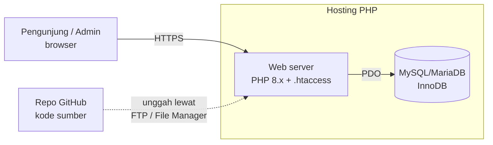

# Tahap 5: Deployment & Maintenance

Proyek: **LaPhish: Lapor dan Cek Phishing di Kampus**
Dasar: `03_implementasi.md` dan `04_pengujian.md`.

Status: **rencana** (2026-11-21). Sesuai ketentuan tugas, aplikasi fase 1 berjalan di localhost. Dokumen ini berisi skema jika aplikasi di-deploy online di masa mendatang, beserta rencana pemeliharaan dan pengembangannya. Kelayakan hosting gratis sudah **diuji langsung** pada 2026-11-21 (bagian 3), dan hasilnya menentukan skema yang dipilih.

## 1. Tujuan deploy

Deploy online yang direncanakan adalah **demo publik dengan data dummy**, untuk portofolio dan agar aplikasi bisa dicoba tanpa memasang XAMPP. Demo ini **tidak dipakai untuk laporan phishing sungguhan**. Pemakaian nyata oleh unit TI kampus memerlukan server sendiri (bagian 7).

## 2. Skema yang dipilih

**Shared hosting berbayar** yang menyediakan Apache, PHP 8.1 atau lebih baru, dan MySQL/MariaDB dengan hak membuat view.

Rencana awal memakai hosting PHP gratis. Uji langsung di bagian 3 menunjukkan hosting gratis mendukung InnoDB, foreign key, RESTRICT, CASCADE, dan PHP 8.3, tetapi **menolak pembuatan view** (`#1142 - CREATE VIEW command denied`). Padahal LaPhish membaca status terakhir setiap laporan lewat view `v_report_status`. Sesuai aturan keputusan di bagian 3, skema deploy dipindah ke shared hosting berbayar.

### Perbandingan opsi

| Kriteria | Hosting gratis (diuji, tidak lolos) | Shared hosting berbayar (dipilih) | Server unit TI (pemakaian nyata) |
|---|---|---|---|
| Biaya | Gratis | Biaya bulanan atau tahunan | Ditanggung kampus |
| Foreign key dan view | Foreign key berjalan, **view ditolak** (bagian 3) | Umumnya didukung, tetap diuji dengan U1–U6 sebelum aplikasi diunggah | Didukung penuh, sama seperti XAMPP |
| Kendali konfigurasi | Terbatas, tanpa SSH | Terbatas (cPanel) | Penuh |
| Data laporan sungguhan | Tidak layak | Kurang ideal (data di pihak ketiga) | Layak, data tetap di kampus |
| Cocok untuk | Tidak dipakai | Demo publik dengan data dummy | Operasional unit TI |

Platform yang biasa dipakai untuk aplikasi Python (Streamlit Cloud, Hugging Face Spaces) tidak menjalankan PHP + MySQL. Vercel menjalankan PHP hanya lewat runtime komunitas dalam bentuk *serverless function*, tanpa MySQL bawaan dan tanpa dukungan `.htaccess`. Render memerlukan Docker untuk PHP. Karena itu ketiganya tidak dipilih.

### Hosting PHP gratis yang dibandingkan

Dicek 2026-11-21. Baris "Hasil uji" berasal dari uji langsung di bagian 3. Baris lainnya berasal dari halaman resmi atau ulasan pihak ketiga.

| Kriteria | InfinityFree | Byet.host | TinkerHost | AwardSpace |
|---|---|---|---|---|
| Pengelola platform | iFastNet | iFastNet | Paket gratisnya berjalan di platform iFastNet (server database `byetcluster.com`, panel vPanel) | AwardSpace |
| PHP | 8.3 | 8.3 | 8.3 (terlihat di panel) | **Hanya PHP 5 dan 7** di paket gratis, sehingga **tidak memenuhi** syarat PHP 8.1 |
| InnoDB | Ditambahkan 2022 (forum) | Mengikuti iFastNet | Tersedia (hasil uji) | Tersedia, termasuk paket gratis (halaman resmi) |
| View | Tidak termasuk hak akun (forum, 2019) | Mengikuti iFastNet | **Ditolak** (hasil uji) | Tidak ada data |
| Keputusan | Tidak dipilih: platform sama dengan TinkerHost | Tidak dipilih: platform sama dengan TinkerHost | Diuji, tidak lolos U4 | Gugur karena versi PHP |

Ketiga layanan pertama berjalan di platform yang sama, sehingga hasil uji di TinkerHost mewakili ketiganya.

## 3. Uji kelayakan sebelum deploy

Forum resmi InfinityFree pernah menyatakan (2019) bahwa paket gratis hanya mendukung MyISAM, foreign key diabaikan, dan hak `CREATE VIEW` tidak termasuk yang diberikan. Pada 2022 InnoDB sudah ditambahkan, tetapi masih ada laporan galat `REFERENCES command not allowed` (1142) saat membuat foreign key. Karena bukti ini tercampur dan sebagian sudah lama, kelayakan **diuji langsung** sebelum aplikasi diunggah ke hosting mana pun.

### Hasil uji di hosting gratis (2026-11-21)

Lingkungan: paket gratis TinkerHost, MariaDB 11.4.13 (server `byetcluster.com`), phpMyAdmin 4.9. Uji memakai tabel sementara `t_induk`, `t_anak`, dan `t_anak2` di database uji kosong, lalu semuanya dihapus. Kode dan data LaPhish tidak diunggah.

| No | Yang diuji | Cara | Lolos jika | Hasil | Status |
|---|---|---|---|---|---|
| — | Hak akun database | Membaca `information_schema.SCHEMA_PRIVILEGES` | — | SELECT, INSERT, UPDATE, DELETE, CREATE, DROP, INDEX, ALTER, LOCK TABLES. Tidak ada `CREATE VIEW` dan `REFERENCES`. Engine bawaan server adalah MyISAM | Info |
| U1 | Engine InnoDB | `CREATE TABLE ... ENGINE=InnoDB`, lalu baca engine di `information_schema.TABLES` | Tercatat `InnoDB` | Kedua tabel tercatat `InnoDB` | Lolos |
| U2 | Foreign key | `CREATE TABLE t_anak (... CONSTRAINT fk_uji FOREIGN KEY ... REFERENCES t_induk(id) ON DELETE RESTRICT)` | Tidak ada galat, constraint tercatat | Tanpa galat. `fk_uji` tercatat dengan `ON DELETE RESTRICT` | Lolos |
| U3 | ON DELETE RESTRICT | Hapus baris induk yang masih dipakai | Ditolak dengan galat 1451 | `#1451 - Cannot delete or update a parent row: a foreign key constraint fails` | Lolos |
| U3b | ON DELETE CASCADE | Tabel `t_anak2` dengan `ON DELETE CASCADE`, isi 2 baris anak, lalu hapus induknya | Baris anak ikut terhapus | Sisa baris anak: 0 | Lolos |
| U4 | View | `CREATE VIEW v_uji AS SELECT ...` | View berhasil dibuat | `#1142 - CREATE VIEW command denied to user` | **Gagal** |
| U5 | Versi PHP | Halaman pengaturan akun di panel | 8.1 atau lebih baru | PHP 8.3 | Lolos |
| U6 | Perlindungan folder | Unggah `.htaccess` berisi `Require all denied`, lalu buka dari browser | Muncul 403 | Tidak dijalankan, karena U4 sudah gagal. Panel menyatakan `.htaccess` aktif | Tidak diuji |

**Kesimpulan:** hosting gratis **tidak lolos** karena U4. Klaim lama bahwa foreign key diabaikan sudah tidak berlaku: foreign key, RESTRICT, dan CASCADE berjalan sama seperti di XAMPP. Penghalangnya tinggal hak `CREATE VIEW`.

**Aturan keputusan:** semua uji lolos berarti lanjut ke bagian 4. Satu saja gagal berarti pindah ke shared hosting berbayar dan menjalankan uji U1–U6 yang sama di sana sebelum aplikasi diunggah.

Desain database **tidak** diubah agar muat di hosting gratis. Foreign key dengan aturan RESTRICT/CASCADE adalah inti integritas data (FR-13, `02a_desain_database.md`), dan view `v_report_status` menjadi satu-satunya tempat aturan "status terakhir" ditulis. Mengganti view dengan subquery di kode PHP (dipakai di 4 file) secara teknis bisa membuat hosting gratis lolos. Tetapi perubahan itu tidak diperlukan untuk tugas yang berjalan di localhost, dan berarti pengujian harus diulang. Jika nanti tetap ingin memakai hosting gratis, perubahan ini masuk rencana pengembangan (bagian 7).

## 4. Langkah deploy

Langkah ini berlaku untuk shared hosting berbayar dengan panel seperti cPanel.

1. **Jalankan uji U1–U6** (bagian 3) di hosting yang dipilih, dengan tabel uji sementara, sebelum mengunggah apa pun. Lanjut hanya jika semuanya lolos.
2. **Buat database lewat panel.** Hosting memberi nama database berawalan (misalnya `xxxx_laphish`), username, password, dan alamat host MySQL. Alamat host belum tentu `localhost`.
3. **Siapkan file SQL versi hosting.** Salin `database/laphish.sql`, lalu hapus dua baris awal `CREATE DATABASE ...` dan `USE laphish;`, karena database sudah dibuat oleh panel dan akun hosting tidak berhak membuat database sendiri. Impor salinan ini ke database tadi lewat phpMyAdmin hosting.
4. **Unggah kode** lewat FTP atau File Manager ke folder web (`htdocs` atau `public_html`). Yang **tidak** diunggah: `.git/`, `.claude/`, `database/`, serta dokumen tugas dari dosen (PDF deskripsi dan `Penjelasan Tambahan.txt`).
5. **Buat `includes/config.php` di server** dari `config.example.php`, isi dengan data dari langkah 2, dan pastikan `'debug' => false`. File ini hanya ada di server, tidak di repo.
6. **Ganti password admin demo.** Password demo tercantum di README publik, jadi harus diganti sebelum situs bisa diakses. Hash baru dibuat di komputer sendiri dengan `password_hash()`, lalu disimpan lewat phpMyAdmin: `UPDATE admins SET password_hash = '<hash baru>' WHERE username = 'admin';`. Password baru tidak ditulis di repo.
7. **Aktifkan HTTPS** di panel dan arahkan semua akses `http://` ke `https://` lewat `.htaccess`.
8. **Uji asap (smoke test)** di alamat online, memakai kasus dari `04_pengujian.md`: TC-01 (beranda), TC-02 (kirim laporan), TC-15 (lacak), TC-20 (cek), TC-30 (login), TC-44 dan TC-48 (RESTRICT), TC-37 (CASCADE), TC-55 (galat koneksi tanpa detail teknis), dan TC-56 (file sensitif terkunci).

## 5. Penyesuaian kode sebelum online

Penyesuaian berikut belum diperlukan di localhost, tetapi dikerjakan sebelum aplikasi bisa diakses publik:

| No | Penyesuaian | Alasan |
|---|---|---|
| P1 | Cookie session diberi atribut `secure` saat diakses lewat HTTPS | Cookie login tidak terkirim lewat koneksi tanpa enkripsi |
| P2 | Token CSRF pada semua form admin | Saat ini perlindungan bergantung pada cookie `SameSite=Lax`. Token CSRF menambah lapisan pengaman yang tidak bergantung pada browser |
| P3 | Batas percobaan login (misalnya jeda setelah 5 kali gagal) | Mencegah tebak password berulang |
| P4 | Pembatasan kiriman di formulir Lapor (misalnya *honeypot* dan batas kiriman per sesi) | Formulir publik tanpa login rawan dikirimi laporan sampah |
| P5 | User database khusus dengan hak terbatas (`SELECT`, `INSERT`, `UPDATE`, `DELETE`) | Di XAMPP aplikasi memakai `root`. Di server unit TI dibuat user khusus. Di hosting, user diberikan oleh panel |

## 6. Rencana pemeliharaan

| Kegiatan | Frekuensi | Cara |
|---|---|---|
| Cadangan database | Mingguan, dan sebelum setiap perubahan | **Export** di phpMyAdmin, atau `mysqldump` terjadwal lewat cron jika paket menyediakannya. Simpan 4 cadangan terakhir di luar hosting, tidak di repo |
| Reset data demo | Bila data demo berantakan oleh kiriman pengunjung | Impor ulang file SQL versi hosting (bagian 4 langkah 3) |
| Cek ketersediaan situs | Mingguan | Buka beranda dan halaman Cek. Jika situs ditangguhkan hosting, pulihkan dari cadangan terakhir |
| Pantau galat | Mingguan | Baca log galat PHP di panel hosting. Galat koneksi database dicatat lewat `error_log()` tanpa ditampilkan ke pengunjung |
| Pembaruan perangkat lunak | Per semester | Cek versi PHP di panel serta rilis keamanan Bootstrap dan Bootstrap Icons, lalu perbarui file di `assets/vendor/` |
| Alur perubahan kode | Setiap perubahan | Ubah dan uji di localhost (ulang kasus di `04_pengujian.md` yang terdampak), commit ke GitHub, lalu unggah file yang berubah |
| Ganti password admin | Per semester, atau segera jika diduga bocor | Seperti bagian 4 langkah 6 |

### Kebijakan penghapusan data

**Kapan admin menghapus laporan.** Hapus dipakai hanya jika datanya memang tidak layak disimpan:
1. Spam atau laporan iseng (isian acak atau bercanda).
2. Laporan ganda dari kejadian yang sama. Satu dipertahankan, sisanya dihapus.
3. Data pribadi atau sensitif di kronologi, misalnya kata sandi atau nomor identitas. Admin tidak bisa mengedit kronologi, jadi laporannya yang dihapus.
4. Permintaan pelapor agar laporannya ditarik.
5. Data percobaan atau pengujian yang tidak sengaja masuk.

Laporan yang salah atau tidak terbukti tidak dihapus, tetapi diberi status **Tidak valid** agar tetap tercatat.

**Akibat menghapus laporan:**
- Penghubung ke indikator dan riwayat statusnya ikut terhapus (`ON DELETE CASCADE`). Indikatornya tetap ada.
- Kode tiketnya hilang. Halaman Lacak menjawab "Kode tiket tidak ditemukan", tanpa membedakan tiket yang dihapus dari tiket yang salah ketik.
- Hasil fitur Cek tidak berubah, karena Cek membaca tabel `indicators`. Hanya jumlah laporan terkaitnya yang berkurang.

**Kapan indikator bisa dihapus.** Hanya jika tidak terkait laporan mana pun (kolom "Laporan" bernilai 0), yaitu indikator yang dibuat admin sendiri dan belum dikaitkan, atau indikator milik laporan yang sudah dihapus. Selama masih terkait, database menolak penghapusannya (`ON DELETE RESTRICT`) dan tombol Hapus dinonaktifkan di antarmuka (FR-13).

**Hati-hati menghapus indikator yang sudah diverifikasi.** Indikator berstatus Phishing yang dihapus tidak lagi diperingatkan di Cek, dan pengguna berikutnya melihat "Belum ada data" untuk nilai yang pernah terbukti berbahaya. Indikator yang salah sebaiknya diubah menjadi "Bukan phishing" dengan catatan, bukan dihapus.

## 7. Rencana pengembangan

**Jangka pendek (setelah tugas dinilai)**
- Penyesuaian P1–P4 di bagian 5.
- Jejak audit perubahan laporan: tabel riwayat perubahan berisi nilai lama, nilai baru, admin, dan waktu, sehingga koreksi kategori dan kanal bisa ditelusuri. Saat ini hanya `updated_at` yang menunjukkan kapan terakhir diubah.
- Pembatasan percobaan di halaman Lacak: kode tiket adalah satu-satunya "kunci" dan kini membuka kronologi serta indikator laporan. Kode berbentuk `LP-` dan 8 karakter dari 32 pilihan (sekitar 1,1 triliun kemungkinan) sehingga sulit ditebak, tetapi belum ada batas jumlah percobaan. Rencananya: hitung kode salah per sesi dan tolak pencarian sementara (misalnya 5 kali salah dalam beberapa menit). Untuk server kampus, hitungan per alamat IP yang disimpan di tabel atau file lebih kuat dan dibahas saat tahap deploy. Pembatasan ini tidak mencegah kebocoran kode lewat screenshot atau grup chat.
- Jika demo ingin tetap gratis: mengganti view `v_report_status` dengan subquery di kode PHP, lalu mengulang uji Black-Box yang terdampak dan uji U1–U6 di hosting gratis (bagian 3).
- Fitur yang ditunda dari fase 1: halaman kelola akun admin (termasuk ganti password lewat aplikasi), grafik di dashboard, dan status "Selesai".

**Fase 2: klasifikasi URL phishing**
- Melatih model klasifikasi URL dari dataset publik, lalu mengujinya dengan indikator LaPhish yang sudah diverifikasi admin (status Phishing atau Bukan phishing).
- Hasil model ditampilkan di halaman Cek sebagai **skor pendamping**, bukan pengganti verifikasi admin.

**Pemakaian nyata oleh unit TI**
- Pindah ke server unit TI kampus dengan HTTPS dan user database khusus (P5).
- Kebijakan privasi: identitas pelapor (nama, email) dihapus setelah jangka waktu tertentu yang disepakati unit TI. Indikator tetap disimpan sebagai data keamanan.
- Akun pelapor dan notifikasi status ke email pelapor, jika memang dibutuhkan.

## 8. Sumber

Dicek 2026-11-21.
- Uji langsung di paket gratis TinkerHost, 2026-11-21 (bagian 3).
- AwardSpace, *Free Web Hosting* (versi PHP dan MySQL paket gratis): https://www.awardspace.com/free-hosting/
- AwardSpace, *How Do I Create a MySQL Table That Uses the InnoDB Storage Engine?*: https://awardspace.com/kb/create-innodb-database
- DeployHQ, *9 Actually-Free PHP Hosting Options in 2026*: https://deployhq.com/blog/how-to-deploy-a-php-website-for-free
- TechRadar, *InfinityFree web hosting review*: https://www.techradar.com/reviews/infinity-free
- Forum InfinityFree, *Complete list of all MySQL limitations?* (Juni 2019): https://forum.infinityfree.com/t/complete-list-of-all-mysql-limitations/17174
- Forum InfinityFree, *How to create foreign keys* (2022): https://forum.infinityfree.net/t/how-to-create-foreign-keys/62006/5
- Forum InfinityFree, *1142 REFERENCES command not allowed for user*: https://forum.infinityfree.com/t/1142-references-command-not-allowed-for-user/52728
