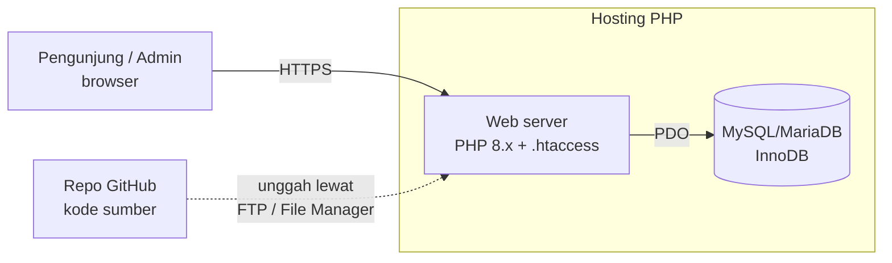

# Tahap 5 — Deployment & Maintenance

Proyek: **LaporPhish: Lapor dan Cek Phishing di Kampus**
Dasar: `03_implementasi.md` dan `04_pengujian.md`.

Status: **rencana** (2026-11-21). Sesuai ketentuan tugas, aplikasi fase 1 berjalan di localhost. Dokumen ini berisi skema jika aplikasi di-deploy online di masa mendatang, beserta rencana pemeliharaan dan pengembangannya.

## 1. Tujuan deploy

Deploy online yang direncanakan adalah **demo publik dengan data dummy**, untuk portofolio dan agar aplikasi bisa dicoba tanpa memasang XAMPP. Demo ini **tidak dipakai untuk laporan phishing sungguhan**. Pemakaian nyata oleh unit TI kampus memerlukan server sendiri (bagian 7).

## 2. Skema yang dipilih

**Hosting PHP gratis** (contoh: InfinityFree), dengan satu syarat: lolos uji kelayakan di bagian 3 lebih dulu. Jika tidak lolos, demo dipindah ke **shared hosting berbayar** dengan langkah yang sama.

### Perbandingan opsi

| Kriteria | Hosting gratis (dipilih untuk demo) | Shared hosting berbayar (cadangan) | Server unit TI (pemakaian nyata) |
|---|---|---|---|
| Biaya | Gratis | Biaya bulanan atau tahunan | Ditanggung kampus |
| Foreign key dan view | **Belum pasti**, harus diuji (bagian 3) | Umumnya didukung, tetap diuji sebelum membeli | Didukung penuh, sama seperti XAMPP |
| Kendali konfigurasi | Terbatas, tanpa SSH dan cron | Terbatas (cPanel) | Penuh |
| Data laporan sungguhan | Tidak layak | Kurang ideal (data di pihak ketiga) | Layak, data tetap di kampus |
| Cocok untuk | Demo portofolio | Demo jika hosting gratis gagal uji | Operasional unit TI |

Platform yang biasa dipakai untuk aplikasi Python (Streamlit Cloud, Hugging Face Spaces) tidak menjalankan PHP + MySQL. Render memerlukan Docker untuk PHP, sehingga tidak dipilih.

### Spesifikasi hosting gratis yang tercatat

Dicek 2026-11-21 dari ulasan pihak ketiga (bukan halaman resmi), jadi angkanya diperiksa ulang di panel saat mendaftar:

| Bagian | Keterangan |
|---|---|
| PHP | 8.3 (sumber lain menyebut 8.2). LaporPhish butuh **PHP 8.1 atau lebih baru** karena memakai tipe kembalian `never` |
| Penyimpanan | 5 GB |
| Database | Hingga 400 database MySQL, dibuat lewat panel |
| SSL | Gratis (Let's Encrypt) |
| Batas | Sekitar 50.000 hit per hari, waktu eksekusi PHP maksimal 10 detik, tanpa SSH. Ketersediaan cron di paket gratis tidak konsisten antarsumber |

## 3. Uji kelayakan sebelum deploy

Forum resmi InfinityFree pernah menyatakan (2019) bahwa paket gratis hanya mendukung MyISAM, foreign key diabaikan, dan hak `CREATE VIEW` tidak termasuk yang diberikan. Pada 2022 InnoDB sudah ditambahkan, tetapi masih ada laporan galat `REFERENCES command not allowed` (1142) saat membuat foreign key. Karena bukti ini tercampur dan sebagian sudah lama, kelayakan **diuji langsung** di akun hosting sebelum aplikasi diunggah.

Uji dijalankan di phpMyAdmin hosting dengan tabel uji sementara, lalu tabel itu dihapus:

| No | Yang diuji | Cara | Lolos jika |
|---|---|---|---|
| U1 | Engine InnoDB | `CREATE TABLE t_induk (...) ENGINE=InnoDB`, lalu `SHOW TABLE STATUS` | Engine tercatat `InnoDB`, bukan `MyISAM` |
| U2 | Foreign key | `CREATE TABLE t_anak (... FOREIGN KEY ... REFERENCES t_induk ...)` | Tidak muncul galat 1142 |
| U3 | ON DELETE RESTRICT | Hapus baris induk yang masih dipakai | Muncul galat 1451 (penghapusan ditolak) |
| U4 | View | `CREATE VIEW v_uji AS SELECT ...` | View berhasil dibuat |
| U5 | Versi PHP | Lihat di panel | 8.1 atau lebih baru |
| U6 | Perlindungan folder | Unggah `.htaccess` berisi `Require all denied` ke folder uji, lalu buka dari browser | Muncul 403 |

**Aturan keputusan:** semua lolos berarti lanjut ke bagian 4. Satu saja gagal berarti **pindah ke shared hosting berbayar** dan ulangi uji yang sama sebelum membeli paket.

Desain database **tidak** diubah agar muat di hosting gratis. Foreign key dengan aturan RESTRICT/CASCADE dan view `v_report_status` adalah inti integritas data (FR-13, `02a_desain_database.md`). Tanpa keduanya, kategori yang masih dipakai bisa terhapus dan meninggalkan laporan tanpa kategori.

## 4. Langkah deploy

1. **Buat database lewat panel.** Hosting memberi nama database berawalan (misalnya `xxxx_laporphish`), username, password, dan alamat host MySQL. Alamat host belum tentu `localhost`.
2. **Siapkan file SQL versi hosting.** Salin `database/laporphish.sql`, lalu hapus dua baris awal `CREATE DATABASE ...` dan `USE laporphish;`, karena database sudah dibuat oleh panel dan akun hosting tidak berhak membuat database sendiri. Impor salinan ini ke database tadi lewat phpMyAdmin hosting.
3. **Unggah kode** lewat FTP atau File Manager ke folder web (`htdocs`). Yang **tidak** diunggah: `.git/`, `.claude/`, `database/`, dan file PDF deskripsi tugas.
4. **Buat `includes/config.php` di server** dari `config.example.php`, isi dengan data dari langkah 1, dan pastikan `'debug' => false`. File ini hanya ada di server, tidak di repo.
5. **Ganti password admin demo.** Password demo tercantum di README publik, jadi harus diganti sebelum situs bisa diakses. Hash baru dibuat di komputer sendiri dengan `password_hash()`, lalu disimpan lewat phpMyAdmin: `UPDATE admins SET password_hash = '<hash baru>' WHERE username = 'admin';`. Password baru tidak ditulis di repo.
6. **Aktifkan HTTPS** di panel dan arahkan semua akses `http://` ke `https://` lewat `.htaccess`.
7. **Uji asap (smoke test)** di alamat online, memakai kasus dari `04_pengujian.md`: TC-01 (beranda), TC-02 (kirim laporan), TC-15 (lacak), TC-20 (cek), TC-30 (login), TC-44 dan TC-48 (RESTRICT), TC-37 (CASCADE), TC-55 (galat koneksi tanpa detail teknis), dan TC-56 (file sensitif terkunci).

## 5. Penyesuaian kode sebelum online

Penyesuaian berikut belum diperlukan di localhost, tetapi dikerjakan sebelum aplikasi bisa diakses publik:

| No | Penyesuaian | Alasan |
|---|---|---|
| P1 | Cookie session diberi atribut `secure` saat diakses lewat HTTPS | Cookie login tidak terkirim lewat koneksi tanpa enkripsi |
| P2 | Token CSRF pada semua form admin | Saat ini perlindungan bergantung pada cookie `SameSite=Lax`. Token CSRF menambah lapisan pengaman yang tidak bergantung pada browser |
| P3 | Batas percobaan login (misalnya jeda setelah 5 kali gagal) | Mencegah tebak password berulang |
| P4 | Pembatasan kiriman di formulir Lapor (misalnya *honeypot* dan batas kiriman per sesi) | Formulir publik tanpa login rawan dikirimi laporan sampah |
| P5 | User database khusus dengan hak terbatas (`SELECT`, `INSERT`, `UPDATE`, `DELETE`) | Di XAMPP aplikasi memakai `root`. Di server unit TI dibuat user khusus. Di hosting, user diberikan oleh panel |

## 6. Rencana pemeliharaan

| Kegiatan | Frekuensi | Cara |
|---|---|---|
| Cadangan database | Mingguan, dan sebelum setiap perubahan | Cron di paket gratis tidak bisa diandalkan, jadi cadangan dibuat manual lewat **Export** di phpMyAdmin. Simpan 4 cadangan terakhir di luar hosting, tidak di repo |
| Reset data demo | Bila data demo berantakan oleh kiriman pengunjung | Impor ulang file SQL versi hosting (bagian 4 langkah 2) |
| Cek ketersediaan situs | Mingguan | Buka beranda dan halaman Cek. Jika situs ditangguhkan hosting, pulihkan dari cadangan terakhir |
| Pantau galat | Mingguan | Baca log galat PHP di panel hosting. Galat koneksi database dicatat lewat `error_log()` tanpa ditampilkan ke pengunjung |
| Pembaruan perangkat lunak | Per semester | Cek versi PHP di panel serta rilis keamanan Bootstrap dan Bootstrap Icons, lalu perbarui file di `assets/vendor/` |
| Alur perubahan kode | Setiap perubahan | Ubah dan uji di localhost (ulang kasus di `04_pengujian.md` yang terdampak), commit ke GitHub, lalu unggah file yang berubah |
| Ganti password admin | Per semester, atau segera jika diduga bocor | Seperti bagian 4 langkah 5 |

## 7. Rencana pengembangan

**Jangka pendek (setelah tugas dinilai)**
- Penyesuaian P1–P4 di bagian 5.
- Fitur yang ditunda dari fase 1: halaman kelola akun admin (termasuk ganti password lewat aplikasi), grafik di dashboard, dan status "Selesai".

**Fase 2: klasifikasi URL phishing**
- Melatih model klasifikasi URL dari dataset publik, lalu mengujinya dengan indikator LaporPhish yang sudah diverifikasi admin (status Phishing atau Bukan phishing).
- Hasil model ditampilkan di halaman Cek sebagai **skor pendamping**, bukan pengganti verifikasi admin.

**Pemakaian nyata oleh unit TI**
- Pindah ke server unit TI kampus dengan HTTPS dan user database khusus (P5).
- Kebijakan privasi: identitas pelapor (nama, email) dihapus setelah jangka waktu tertentu yang disepakati unit TI. Indikator tetap disimpan sebagai data keamanan.
- Akun pelapor dan notifikasi status ke email pelapor, jika memang dibutuhkan.

## 8. Sumber

Dicek 2026-11-21.
- DeployHQ, *9 Actually-Free PHP Hosting Options in 2026*: https://deployhq.com/blog/how-to-deploy-a-php-website-for-free
- TechRadar, *InfinityFree web hosting review*: https://www.techradar.com/reviews/infinity-free
- Forum InfinityFree, *Complete list of all MySQL limitations?* (Juni 2019): https://forum.infinityfree.com/t/complete-list-of-all-mysql-limitations/17174
- Forum InfinityFree, *How to create foreign keys* (2022): https://forum.infinityfree.net/t/how-to-create-foreign-keys/62006/5
- Forum InfinityFree, *1142 REFERENCES command not allowed for user*: https://forum.infinityfree.com/t/1142-references-command-not-allowed-for-user/52728
